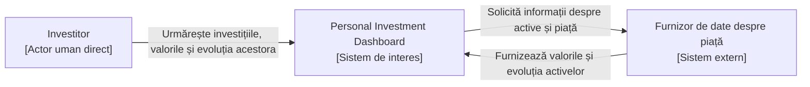

# Laboratorul 1: Definește produsul inițial

## Scop

Definește un Personal Investment Dashboard restrâns fără să proiectezi
arhitectura sa internă sau să selectezi tehnologia.

### Cererea clientului

> Ajută-mă să îmi urmăresc investițiile.

---

# 1. Cercetarea produsului

### Întrebarea de cercetare

> Cum ajută produsele existente un Utilizator să urmărească informațiile
> despre piață și ce părți aparțin primei versiuni a acestui Dashboard?

| Produs | Utilizatorul probabil și obiectivul său | Model reutilizabil |
| --- | --- | --- |
| Google Finance | Investitorul sau potențialul investitor urmărește evoluția pieței și a activelor financiare de interes pentru a înțelege performanța acestora și schimbările relevante de pe piață. | Urmărirea prețului curent și a evoluției activelor financiare. |
| TradingView | Traderul urmărește și analizează în detaliu piețele financiare pentru a identifica tendințe și oportunități de tranzacționare. | Analiza detaliată a evoluției și tendințelor activelor financiare. |

### Surse

- [Google Finance](https://www.google.com/finance/) — permite urmărirea prețurilor și a evoluției activelor financiare prin informații și grafice despre piață.
- [TradingView](https://www.tradingview.com/) — oferă grafice și instrumente pentru analiza detaliată a evoluției și tendințelor activelor financiare.

---

# 2. Părți interesate și actori

## Identificarea părților interesate

| Parte interesată | Motivație | Influență | Motiv |
| --- | --- | --- | --- |
| Investitor | Ridicată | Scăzută | Utilizează direct Dashboard-ul și depinde de informațiile oferite pentru a-și urmări investițiile, dar nu controlează direct deciziile privind produsul. |
| Proprietarul produsului | Ridicată | Ridicată | Este responsabil de direcția produsului și poate stabili domeniul de aplicare, prioritățile și deciziile privind dezvoltarea acestuia. |
| Furnizor de date despre piață | Scăzută | Ridicată | Furnizează informațiile financiare de care Dashboard-ul depinde pentru urmărirea valorii și evoluției activelor. |
| Autoritatea de reglementare financiară | Scăzută | Ridicată | Poate impune reguli și limite care influențează produsul, fără a utiliza direct Dashboard-ul. |

## Matricea părților interesate

| Motivație | Influență scăzută | Influență ridicată                                                    |
| --------- | ----------------- | --------------------------------------------------------------------- |
| Ridicată  | Investitor        | Proprietarul produsului                                               |
| Scăzută   | —                 | Furnizor de date despre piață; Autoritatea de reglementare financiară |

## Clasificarea candidaților

| Candidat                               | Clasificare           | Motiv                                                                                                           |
| -------------------------------------- | --------------------- | --------------------------------------------------------------------------------------------------------------- |
| Investitor                             | Actor uman direct     | Interacționează direct cu Dashboard-ul pentru a-și urmări investițiile și informațiile despre acestea.          |
| Furnizor de date despre piață          | Sistem extern         | Furnizează Dashboard-ului informațiile despre piață necesare urmăririi activelor financiare.                    |
| Proprietarul produsului                | Altă parte interesată | Influențează deciziile și direcția produsului, dar nu participă direct la procesul de urmărire a investițiilor. |
| Autoritatea de reglementare financiară | Altă parte interesată | Poate impune reguli și limite produsului, dar nu interacționează direct cu Dashboard-ul.                        |

---

# 3. Promisiunea și domeniul de aplicare ale produsului

## Promisiunea produsului

Personal Investment Dashboard ajută investitorii să își urmărească
investițiile și evoluția acestora, astfel încât să poată înțelege
valoarea și performanța investițiilor lor pe baza informațiilor
disponibile despre piață.

## Obiective

1. Permite Investitorului să înregistreze și să actualizeze activele
   financiare și cantitățile pe care le deține pentru a-și urmări
   investițiile.
2. Permite Investitorului să vadă valoarea curentă disponibilă a
   fiecărui activ urmărit.
3. Permite Investitorului să urmărească evoluția valorii unui activ
   financiar în timp.
4. Permite Investitorului să vadă valoarea curentă a investițiilor sale
   pe baza celor mai recente informații disponibile despre piață.
5. Permite Investitorului să distingă informațiile actuale despre piață
   de cele învechite sau indisponibile.

## Obiective excluse

1. Efectuarea cumpărărilor sau vânzărilor de active financiare direct
   prin Dashboard.
2. Oferirea de recomandări personalizate privind cumpărarea sau
   vânzarea investițiilor.
3. Urmărirea știrilor financiare și furnizarea de analize sau previziuni
   privind evoluția viitoare a pieței.

Cercetarea produselor existente a confirmat limitarea primei versiuni la
urmărirea investițiilor. Funcționalitățile de tranzacționare observate în
TradingView sunt excluse din prima versiune, deoarece depășesc promisiunea
produsului de a ajuta Investitorul să își urmărească investițiile.

---

# 4. Cerințe funcționale

## DASH-1 — Înregistrarea și actualizarea unei investiții

### Obiectivul actorului

Investitorul trebuie să poată înregistra un activ financiar și cantitatea
pe care o deține și să actualizeze cantitatea atunci când investiția sa
se modifică.

### Povestea de Utilizator

**Ca Investitor, vreau să înregistrez și să actualizez un activ financiar
și cantitatea pe care o dețin, astfel încât Dashboard-ul să reflecte
investiția mea curentă.**

### Definițiile de Făcut

- Investitorul poate înregistra activul și cantitatea deținută.
- Investitorul poate actualiza cantitatea înregistrată pentru un activ
  urmărit.
- Dacă activul nu este acceptat de sursa de date disponibilă,
  Dashboard-ul informează Investitorul că acesta nu poate fi urmărit.
- Înregistrarea sau actualizarea unei investiții în Dashboard nu
  efectuează o tranzacție financiară.

---

## DASH-2 — Vizualizarea valorii curente a unui activ

### Obiectivul actorului

Investitorul trebuie să poată afla valoarea curentă disponibilă a unui
activ urmărit.

### Povestea de Utilizator

**Ca Investitor, vreau să văd valoarea curentă a unui activ urmărit,
astfel încât să cunosc situația sa actuală pe piață.**

### Definițiile de Făcut

- Dashboard-ul afișează cea mai recentă valoare disponibilă pentru
  activul urmărit.
- Dacă valoarea disponibilă este învechită, Dashboard-ul indică faptul
  că informația nu este curentă.
- Dacă valoarea nu poate fi obținută, Dashboard-ul o indică drept
  indisponibilă și nu inventează o valoare.

---

## DASH-3 — Urmărirea evoluției unui activ

### Obiectivul actorului

Investitorul trebuie să poată observa modul în care valoarea unui activ
s-a modificat în timp.

### Povestea de Utilizator

**Ca Investitor, vreau să urmăresc evoluția unui activ financiar,
astfel încât să pot înțelege modul în care valoarea acestuia s-a
schimbat în timp.**

### Definițiile de Făcut

- Dashboard-ul prezintă evoluția valorii activului pentru perioada
  disponibilă.
- Informațiile prezentate corespund activului selectat de Investitor.
- Dacă datele pentru o anumită perioadă lipsesc, Dashboard-ul indică
  faptul că informațiile sunt incomplete.

---

## DASH-4 — Vizualizarea valorii investițiilor

### Obiectivul actorului

Investitorul trebuie să poată afla valoarea curentă a investițiilor sale
urmărite.

### Povestea de Utilizator

**Ca Investitor, vreau să văd valoarea curentă a investițiilor mele
urmărite, astfel încât să pot înțelege situația actuală a acestora.**

### Definițiile de Făcut

- Dashboard-ul prezintă valoarea investițiilor urmărite folosind
  cantitățile înregistrate și cele mai recente informații disponibile
  despre piață.
- Valoarea prezentată corespunde activelor și cantităților înregistrate
  de Investitor.
- Dacă informația necesară pentru un activ este indisponibilă,
  Dashboard-ul nu prezintă rezultatul incomplet drept o valoare complet
  actualizată.

---

## DASH-5 — Starea informațiilor despre piață

### Obiectivul actorului

Investitorul trebuie să poată distinge informațiile actuale de cele
învechite sau indisponibile.

### Povestea de Utilizator

**Ca Investitor, vreau să știu când informațiile despre piață sunt
învechite sau indisponibile, astfel încât să nu interpretez datele
nesigure drept informații curente.**

### Definițiile de Făcut

- Dashboard-ul diferențiază informațiile curente de cele identificate
  ca fiind învechite.
- Dacă furnizorul extern nu oferă informația necesară, Dashboard-ul
  indică rezultatul ca indisponibil.
- O informație lipsă sau învechită nu este prezentată drept informație
  curentă.

---

# 5. C4 System Context

## Responsabilitatea sistemului extern

**Furnizorul de date despre piață** furnizează informațiile necesare
Dashboard-ului pentru afișarea valorii și evoluției activelor financiare.

Personal Investment Dashboard este responsabil să solicite și să interpreteze
aceste informații pentru investițiile urmărite de Investitor.

Dacă informațiile necesare lipsesc, Dashboard-ul le indică drept indisponibile.
Dacă informațiile sunt învechite, Dashboard-ul indică faptul că acestea nu sunt
curente și nu le prezintă drept informații actualizate.