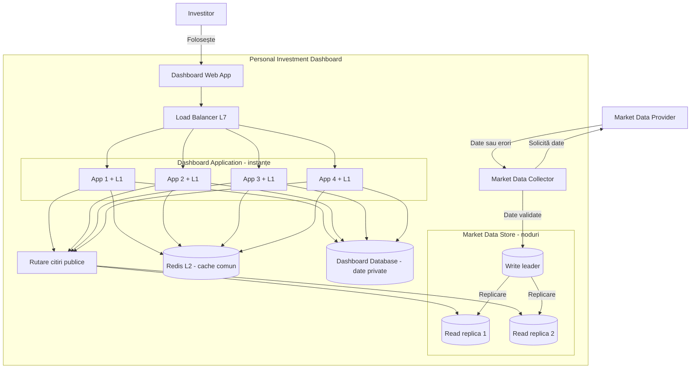
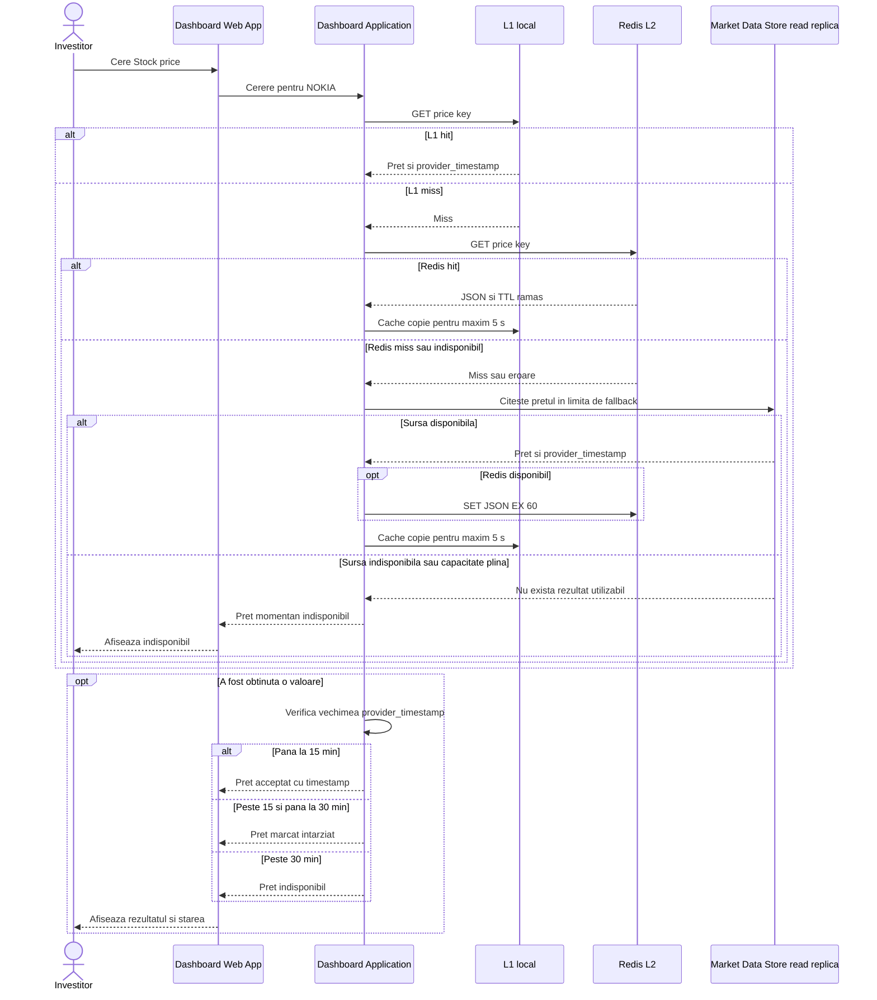
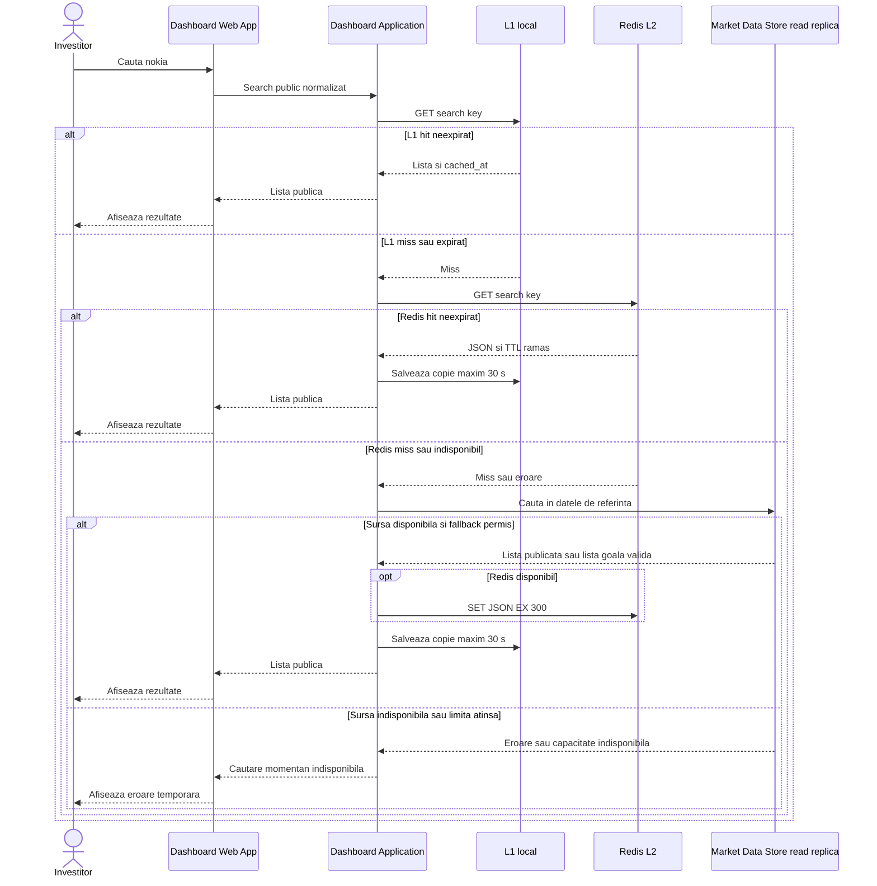

# Laboratorul 4 — Scalarea citirilor Personal Investment Dashboard

## Scop și continuitate

Acest laborator continuă proiectul **Personal Investment Dashboard** din Laboratoarele 1–3 și aplică principiile din **Lecția 5: Scalarea orizontală, memoria cache și disponibilitatea**. Sistemul V1 urmărește Stocks de pe **Nasdaq Helsinki Main Market**, permite consultarea prețurilor, istoricului, căutarea și filtrarea, precum și administrarea investițiilor și a unui Watchlist privat. Nu efectuează tranzacții financiare.

**Cerințe păstrate din Lab 2:** latență observată de utilizator **p95 ≤ 2 secunde** pentru citiri la volumul-țintă; disponibilitate **99,99% în orele de tranzacționare** și **99,9% în afara lor**; un preț este acceptat la vechime **≤ 15 minute**, afișat ca „întârziat” pentru **> 15 și ≤ 30 minute**, iar pentru **> 30 minute** este „indisponibil”; următoarea citire reușită a Watchlist-ului de către același utilizator reflectă modificarea confirmată (*read-your-writes*).

**Încărcarea folosită aici:** scenariul de **3.000 de utilizatori**, pentru care Lab 2 estima **600 Stock price RPS** în regim stabil. Lab 4 cere o **marjă separată de 20%** și rezistență la oprirea unei instanțe Dashboard. Această dimensionare se referă **numai la citirile Stock price**, nu dovedește automat ținta totală de **1.030 RPS** la deschiderea pieței pentru 3.000 de utilizatori și nici ținta de **10.296 RPS** pentru 30.000 de utilizatori din Lab 2.

**Arhitectura păstrată din Lab 3:** Dashboard Web App, Dashboard Application, Dashboard Database, Market Data Collector, Market Data Store. Collector sincronizează periodic datele; o citire Stock price nu solicită direct un preț nou de la Market Data Provider.

---

# 1. Scalarea serviciului și distribuirea cererilor

## 1.1. Calculul numărului de instanțe Dashboard

Date furnizate de cerință:

- Rata pentru 3.000 utilizatori: **600 Stock price RPS**.
- Marjă de capacitate: **20%**.
- Capacitate sigură a unei instanțe gata de lucru: **250 Stock price RPS** la latența-țintă.
- Cerință: păstrarea țintei și **după oprirea unei instanțe**.
- Testul celor 250 RPS/instanță este presupus a fi fost efectuat cu resursele din exemplul HPA al Lecției 5: `requests: 500m CPU, 512Mi RAM`; `limits: 1 CPU, 1Gi RAM`.

**Ținta cu marjă:**

```text
600 × 1,20 = 720 Stock price RPS
```

**Instanțe necesare în absența defectărilor:**

```text
ceil(720 / 250) = ceil(2,88) = 3 instanțe
```

Trei instanțe au capacitatea teoretică de `3 × 250 = 750 RPS`, dar după oprirea uneia rămân doar `2 × 250 = 500 RPS`, insuficient.

**Calculul cu toleranță la pierderea unei instanțe:**

```text
(N - 1) × 250 ≥ 720
N - 1 ≥ 2,88
N ≥ 3,88
N_min = 4 instanțe pregătite
```

| Situație | Instanțe disponibile | Capacitate sigură | Verdict |
| --- | ---: | ---: | --- |
| Regim normal | 4 | 1.000 RPS | Peste ținta de 720 RPS |
| O instanță oprită | 3 | 750 RPS | **Ținta se păstrează** |
| Două instanțe oprite | 2 | 500 RPS | Insuficient |

**Decizie:** minimum **4 instanțe Dashboard Application pregătite** pentru scenariul didactic de 3.000 utilizatori. Cele patru instanțe sunt copii ale **aceluiași container C4**, nu patru servicii cu responsabilități diferite. În cazul unei opriri, Load Balancer trebuie să înceteze rutarea cererilor noi către instanța indisponibilă. Un mecanism HPA poate ajuta la creșterea capacității ulterior, dar nu înlocuiește cele patru instanțe gata de lucru.

## 1.2. Alegerea Load Balancer-ului

**Alegere: L7 (HTTP/HTTPS) cu metoda round robin**, numai între instanțele considerate *ready*.

**Motiv:** citirile Stock price sunt cereri HTTP cu un cost de procesare presupus similar, astfel încât alternarea cererilor între instanțe este simplă și adecvată. La nivelul L7 putem inspecta cereri HTTP și aplica rutarea corespunzătoare.

**Limită:** round robin distribuie numărul cererilor, **nu garantează aceeași utilizare CPU sau aceeași durată de execuție**. Dacă unele cereri (de exemplu History) sunt mai costisitoare, încărcarea se poate dezechilibra. Un Load Balancer singur poate deveni un punct unic de defectare; proiectarea disponibilității sale trebuie completată într-un sistem real. L7 implică și procesarea HTTP și, de regulă, terminarea TLS pentru inspectarea HTTPS.

**Readiness:** răspunde la întrebarea „poate această instanță primi cereri acum?”; instanțele care nu sunt pregătite trebuie excluse din rutare. **Liveness:** detectează blocarea procesului și poate declanșa repornirea, dar nu garantează că bazele de date sunt accesibile.

## 1.3. Ce stare trebuie să supraviețuiască opririi unei instanțe?

| Informație | Unde se păstrează | Motiv |
| --- | --- | --- |
| Conturile și verificarea persistentă a sesiunilor, dacă sunt sesiuni server-side | Dashboard Database / mecanism partajat | Următoarea cerere poate ajunge la altă instanță |
| Investiții și cantități înregistrate | Dashboard Database | Sunt date private și persistente |
| Watchlist și modificări confirmate | Dashboard Database | Asigură regula read-your-writes |
| Prețuri acceptate, istoric, timestamp-uri | Market Data Store | Nu depind de memoria unui proces Dashboard |
| Progresul sincronizării | Market Data Store | Colectorul trebuie să poată relua în siguranță |
| Date temporare ale unei cereri / validări intermediare | Memoria instanței | Pot fi reconstruite la o nouă cerere |
| **Cache L1** cu valori publice | Memoria fiecărei instanțe | Poate dispărea oricând fără pierderea datelor durabile |
| **Cache L2 Redis** | Cache comun, reconstruibil | Nu trebuie considerat sursa definitivă |

**Consecință:** instanțele Dashboard rămân *stateless* din perspectiva stării obligatorii dintre cereri. Pierderea unei instanțe poate întrerupe o cerere activă, dar nu șterge modificări deja confirmate. Pentru adăugări în Watchlist se aplică și protecție la reîncercări, de exemplu unicitate `(user_id, stock_id)`, pentru a preveni duplicatele după pierderea unei confirmări.

---

# 2. Scalarea Market Data Store și diagrama Container actualizată

## 2.1. Calculul replicilor de citire

Cerința Lab 4 oferă **400 Stock price RPS** drept capacitate sigură a fiecărui nod de citire, la latența-țintă. Liderul de scriere se rezervă pentru salvarea datelor acceptate și citiri ce necesită cea mai recentă valoare; **nu îl includem** în capacitatea de citire publică obișnuită.

```text
Țintă publică fără presupuneri despre cache: 720 RPS
Replici necesare = ceil(720 / 400) = ceil(1,8) = 2
Capacitate oferită = 2 × 400 = 800 public-read RPS
```

**Decizie:** un **write leader** și **două read replicas** ale Market Data Store, cu un mecanism de selectare a unei replici eligibile pentru citirile publice. Aceste trei instanțe alcătuiesc **o singură stocare logică**.

Liderul primește scrierile validate de Market Data Collector și replică schimbările către cititori. Replicile pot avea **întârziere de replicare**, astfel încât un preț găsit în replică se afișează numai după verificarea `provider_timestamp` din Lab 2. **Capacitatea de 800 RPS presupune că ambele replici sunt disponibile.** Dacă una se oprește, rămân numai 400 RPS; toleranța la această defecțiune nu este cerută numeric în Lab 4 și ar necesita capacitate/replici suplimentare. Dacă liderul se oprește, este necesară o politică separată de failover; replicile nu devin automat lideri de scriere.

La citirile Watchlist care necesită *read-your-writes*, folosim calea adecvată din **Dashboard Database** (de exemplu, liderul său) și nu un cache public partajat.

## 2.2. Container View actualizat (Mermaid)



**Interpretare:** Load Balancer distribuie cererile numai către cele patru instanțe Dashboard Application pregătite. Fiecare instanță are propriul cache L1 și partajează Redis L2, Dashboard Database și calea de citire din Market Data Store. `Rutare citiri publice` este un **rol logic de selectare a replicii**, nu o nouă bază de date. Market Data Collector continuă să sincronizeze în fundal, fără apel la furnizor pentru fiecare citire.

**Schimbări față de Lab 3:** am adăugat Load Balancer L7, patru instanțe ale Dashboard Application, cache L1 în fiecare instanță, Redis L2 comun și două replici pentru citirile publice ale Market Data Store. **Limita sistemului, componentele logice AuthService/StockService/WatchlistService/InvestmentService/DashboardService și datele durabile nu se schimbă.**

---

# 3. Două cazuri de cache pentru citiri publice

Cache-ul are două niveluri:

- **L1:** memoria locală a instanței Dashboard care primește cererea. Este rapidă, dar orice intrare poate dispărea oricând.
- **L2:** **Redis**, comun celor patru instanțe. Redis poate fi gol sau indisponibil.
- **Sursa durabilă:** `Market Data Store` (date validate persistate), prin replicile de citire publică. Aceasta poate reconstrui atât L1, cât și Redis.

Strategia aleasă este **cache-aside cu TTL simplu**: la *cache miss* se consultă următorul nivel, iar după citirea reușită din sursa durabilă se completează nivelurile de cache. **Nu folosim stale-while-revalidate** pentru cache-ul în sine; regula din Lab 2 privind un *preț întârziat* este diferită de strategia de cache SWR.

Citim mai întâi L1, apoi Redis L2, apoi sursa durabilă. Nu dimensionăm instanțele și replicile pe baza vreunei presupuneri privind procentul de *cache hit*.

## 3.1. Cazul A — Stock price

**Muncă repetată eliminată:** interogări repetate ale aceluiași ultim preț din Market Data Store de către mulți utilizatori; L1 poate evita și apelurile repetate către Redis.

### Contractul cache-ului Stock price

| Decizie | Contract |
| --- | --- |
| Cheie publică | `lab4:stock-price:helsinki:NOKIA` — piața și simbolul identifică rezultatul; nu conține userId |
| Valoare JSON | `symbol`, `price`, `currency`, `provider_timestamp`, `cached_at` |
| Sursă durabilă | Ultimul preț acceptat și timestamp-ul furnizorului din Market Data Store |
| L1 lifetime | **5 secunde** maximum; nu prelungește viața intrării Redis |
| Redis L2 TTL | **60 secunde**, stabilit prin `SET ... EX 60` |
| Freshness / stale / expirare produs | `now - provider_timestamp` **≤15 min**: preț acceptat; **>15–≤30 min**: afișat „întârziat”; **>30 min**: nu este afișat ca preț utilizabil, rezultat „indisponibil” |
| Politica de cache | TTL simplu; după expirare/miss consultăm sursa; **nu** există SWR de cache |
| Securitate | Numai date publice; fără Watchlist, cantități deținute, identitate sau sesiune |
| Eșec | La Redis indisponibil: L1 utilizabil sau fallback limitat la sursă. La sursă indisponibilă și fără copie permisă: „Preț momentan indisponibil” |

**Regulă de prospețime:** fiecare răspuns verifică `provider_timestamp`, inclusiv la L1/L2 hit. `cached_at` spune când am copiat informația în cache, **nu** când a fost observat prețul pe piață. Dacă o intrare expiră în cache, sursa durabilă poate să conțină tot un preț mai vechi de 30 de minute; atunci rezultatul rămâne indisponibil. Pentru o valoare copiată din Redis, L1 se expiră cel târziu la limita TTL rămasă a copiei Redis și la limita produsului, nu reînnoiește perioada de actualitate.

### Secvență A — Stock price: L1 → Redis → Market Data Store



**Ipoteză de secvență:** AuthService verifică identitatea și StockService validează simbolul înaintea citirii, conform Lab 3; aici detaliem strict traseul cache-ului. Sursa poate returna o eroare, un preț lipsă sau un preț prea vechi. Nu există apel nou la Market Data Provider. Dacă Redis nu poate fi completat după o citire durabilă reușită, răspunsul sursei poate fi folosit în continuare.

## 3.2. Cazul B — Search public

**Muncă repetată eliminată:** căutarea aceleiași expresii normalizate în datele de referință Stock de pe Market Data Store. Exemplul este o căutare publică după termenul `nokia`.

**Restricție:** funcția acestui cache este numai *Search public* în catalogul Stock. Nu stocăm rezultate personalizate, Watchlist, investiții ori date de utilizator. În V1, în exemplul de test, ordonarea, limba și pagina rezultatelor sunt fixe. Dacă ulterior devin parametri configurabili, aceștia trebuie adăugați în cheia cache-ului.

### Contractul cache-ului Search

| Decizie | Contract |
| --- | --- |
| Cheie publică | `lab4:search:helsinki:nokia` — piață și textul căutării normalizat la litere mici |
| Valoare JSON | `query`, `market`, `results` (simbol și denumire), `cached_at` |
| Sursă durabilă | Datele de referință Stocks acceptate din Market Data Store, sincronizate zilnic în Lab 2 |
| L1 lifetime | **30 secunde** maximum, limitate de expirarea valorii din Redis |
| Redis L2 TTL | **300 secunde**, stabilit prin `SET ... EX 300` |
| Freshness | Rezultatul cache-ului poate fi tratat ca „actual” timp de cel mult **300 s de la cached_at**, cu condiția să provină din date de referință acceptate; copia din L1 are maximum 30 s |
| Stale / expirare | Nu servim o copie peste limita de 300 s; niciun interval SWR suplimentar. La expirare citim din nou sursa |
| Securitate | Rezultatul este public, fără identificatori sau informații private despre utilizator |
| Eșec | La Redis indisponibil, utilizăm L1 permis sau fallback limitat la sursă. La sursă indisponibilă și fără copie permisă: „Căutare momentan indisponibilă” |

TTL-ul de 5 minute limitează vârsta **copiei cache**, nu garantează că lista bursieră a fost actualizată în acele 5 minute; datele de referință din sursă pot fi sincronizate doar zilnic conform Lab 2. Un rezultat de căutare gol poate fi valid dacă sursa a răspuns cu `results: []`; nu îl confundăm cu defectarea stocării.

### Secvență B — Search: L1 → Redis → Market Data Store



**Ipoteză de secvență:** identitatea și parametrii sunt validați conform Lab 3; această diagramă explică exclusiv traseul cache-ului. `cached_at` se stabilește **când rezultatul este reconstruit din sursa durabilă**, nu se resetează la fiecare `GET` sau transfer Redis → L1.

## 3.3. Pre-warm limitat și regulile de fallback

**Înainte de deschiderea pieței** și **după recuperarea dintr-un restart Redis** putem preîncărca în mod controlat:

- maximum **100 chei Stock price** pentru simbolurile publice cel mai des accesate (din universul estimat la aproximativ 136 Stocks în Lab 2), **numai dacă datele din sursă respectă deja limita de vechime**. Înaintea deschiderii pieței este posibil ca prețurile din sesiunea precedentă să fie prea vechi; în acest caz nu le preîncărcăm ca prețuri disponibile;
- maximum **10 chei Search** pentru expresii publice populare și normalizate, fără parametri personali;
- maximum **110 chei în total per ciclu**, cu un plafon operațional exemplificativ de **20 citiri/s către sursa durabilă** pentru pre-warm. Ordinea se stabilește după accesările publice măsurate; lista se poate modifica, dar plafonul nu.

Pre-warm-ul este o optimizare, **nu o condiție de corectitudine**. Poate fi incomplet chiar înaintea deschiderii pieței dacă furnizorul nu a oferit încă observații suficient de recente; după prima sincronizare acceptată, pot fi încărcate cheile eligibile. Dacă unele chei nu sunt pregătite, următoarea cerere urmează calea L1 → Redis → sursa durabilă, cu fallback controlat. Dacă Redis este gol sau cade, traficul nu trebuie să depășească capacitatea replicilor. Pentru Stock price rezervăm un buget de fallback de cel mult **360 RPS per replică**, deci **720 RPS** în total, sub plafonul nominal de 400 RPS per replică. Alte tipuri de citiri consumă și ele resurse și necesită bugete/teste separate: nu pretindem că 80 RPS rămase în total garantează automat toate cererile din Lab 2.

Dacă capacitatea sigură de fallback este epuizată, sistemul **nu supraîncarcă sursa**: returnează un rezultat explicit de indisponibilitate temporară (de exemplu HTTP 503 și mesajul „Preț momentan indisponibil” / „Căutare momentan indisponibilă”), cu posibilitatea unei reîncercări ulterioare. O intrare L1 încă validă poate fi utilizată chiar dacă Redis este indisponibil, dar nici cache-ul, nici o reîncercare nu permit încălcarea regulii de vechime a prețului.

Pentru a evita valuri de interogări simultane la același cache miss (*cache stampede*), se pot combina cererile concurente pentru aceeași cheie și se poate limita numărul de reconstrucții paralele. Acestea sunt **măsuri propuse**, nu implementări demonstrate de testul cu `redis-cli`.

---

# 4. Demonstrarea practică Redis pe macOS

**Mediu testat:** Redis **8.10.3**, instalat cu Homebrew, pornit prin `brew services start redis`. Testul de conectare `redis-cli PING` a returnat **`PONG`**. Comenzile `DEL`, `GET`, `SET ... EX` și `TTL` de mai jos au fost executate de utilizator în Terminal.

**Limitarea demonstrației:** pentru a ilustra traseul de cache, JSON-urile au fost **construite manual cu date exemplificative** (prețul Nokia de `5.20 EUR` nu este o cotație bursieră verificată). „Citirea sursei durabile” este arătată **la nivel de proiectare, în diagrame**, nu a fost executată împotriva unui Market Data Store real. Testul practic confirmă funcționarea Redis, nu integrarea cu un backend financiar funcțional.

## 4.1. Stock price — transcrierea executării

**Cheie:** `lab4:stock-price:helsinki:NOKIA`

**1. Cache gol / miss:**

```console
$ redis-cli DEL lab4:stock-price:helsinki:NOKIA
(integer) 0
$ redis-cli GET lab4:stock-price:helsinki:NOKIA
(nil)
```

**2. Umplerea cache-ului după citirea durabilă simulată:**

Comanda a generat `cached_at` din timpul UTC curent și `provider_timestamp` cu 15 minute mai devreme. Într-o aplicație reală, `provider_timestamp` ar veni **din datele acceptate ale furnizorului**, nu ar fi inventat prin scăderea a 15 minute.

```sh
NOW_UTC=$(date -u +"%Y-%m-%dT%H:%M:%SZ")
PROVIDER_TIME=$(date -u -v-15M +"%Y-%m-%dT%H:%M:%SZ")
redis-cli SET lab4:stock-price:helsinki:NOKIA \
"{\"symbol\":\"NOKIA\",\"price\":5.20,\"currency\":\"EUR\",\"provider_timestamp\":\"$PROVIDER_TIME\",\"cached_at\":\"$NOW_UTC\"}" EX 60
```

**Rezultat obținut:** `OK`.

**3. Cache hit și TTL:**

```console
$ redis-cli GET lab4:stock-price:helsinki:NOKIA
"{\"symbol\":\"NOKIA\",\"price\":5.20,\"currency\":\"EUR\",\"provider_timestamp\":\"2026-11-09T21:38:38Z\",\"cached_at\":\"2026-11-09T21:53:38Z\"}"
$ redis-cli TTL lab4:stock-price:helsinki:NOKIA
(integer) 49
```

**Valoarea JSON stocată (formatată pentru lizibilitate):**

```json
{
  "symbol": "NOKIA",
  "price": 5.20,
  "currency": "EUR",
  "provider_timestamp": "2026-11-09T21:38:38Z",
  "cached_at": "2026-11-09T21:53:38Z"
}
```

**Interpretare:** Redis a returnat prețul memorat; `TTL = 49` înseamnă că mai rămâneau 49 secunde până la expirarea **cheii Redis**. Diferența dintre cele două timestamp-uri este de 15 minute, ceea ce arată că o intrare nouă în cache poate conține deja un preț întârziat. Respectarea regulii de vechime se calculează folosind **`provider_timestamp`**, nu `cached_at` sau TTL.

## 4.2. Search — transcrierea executării

**Cheie:** `lab4:search:helsinki:nokia`

**1. Cache gol / miss:**

```console
$ redis-cli DEL lab4:search:helsinki:nokia
(integer) 0
$ redis-cli GET lab4:search:helsinki:nokia
(nil)
```

**2. Umplerea cache-ului după citirea durabilă simulată:**

```sh
NOW_UTC=$(date -u +"%Y-%m-%dT%H:%M:%SZ")
redis-cli SET lab4:search:helsinki:nokia \
"{\"query\":\"nokia\",\"market\":\"Nasdaq Helsinki Main Market\",\"results\":[{\"symbol\":\"NOKIA\",\"name\":\"Nokia Oyj\"}],\"cached_at\":\"$NOW_UTC\"}" EX 300
```

**Rezultat obținut:** `OK`.

**3. Cache hit și TTL:**

```console
$ redis-cli GET lab4:search:helsinki:nokia
"{\"query\":\"nokia\",\"market\":\"Nasdaq Helsinki Main Market\",\"results\":[{\"symbol\":\"NOKIA\",\"name\":\"Nokia Oyj\"}],\"cached_at\":\"2026-11-09T21:56:09Z\"}"
$ redis-cli TTL lab4:search:helsinki:nokia
(integer) 300
```

**Valoarea JSON stocată (formatată):**

```json
{
  "query": "nokia",
  "market": "Nasdaq Helsinki Main Market",
  "results": [
    {"symbol": "NOKIA", "name": "Nokia Oyj"}
  ],
  "cached_at": "2026-11-09T21:56:09Z"
}
```

**Interpretare:** rezultatul unei căutări publice a fost salvat și recuperat. `TTL = 300` reprezintă 5 minute rămase până la expirare la momentul verificării. Valorile testului sunt demonstrative; datele reale Search ar proveni din referințele de piață stocate.

## 4.3. Persistența Redis — verificată prin comenzi

```console
$ redis-cli CONFIG GET save
1) "save"
2) "3600 1 300 100 60 10000"

$ redis-cli CONFIG GET appendonly
1) "appendonly"
2) "no"
```

**Interpretare: RDB activ, AOF dezactivat.** Configurația RDB permite snapshot-uri atunci când este îndeplinită cel puțin una dintre condițiile indicate: cel puțin **1 schimbare în 3.600 s**, **100 schimbări în 300 s** sau **10.000 schimbări în 60 s**. Nu înseamnă că fiecare `SET` este salvat pe disc în momentul executării. `appendonly = no` confirmă că nu este activat jurnalul AOF.

**Dacă Redis repornește cu cache gol:** citirile încearcă L1 (dacă instanța încă îl deține), apoi Redis, iar la miss apelează **limitat** Market Data Store și reconstruiesc intrările cu `SET ... EX`. Sistemul nu pierde datele durabile de piață deoarece Redis nu este sursa principală. Un snapshot RDB, dacă este disponibil, poate reface o parte dintre chei după restart, dar fiecare valoare recuperată trebuie verificată din nou față de `cached_at` și, la Stock price, `provider_timestamp`.

**De ce TTL nu dovedește prospețimea datelor:** TTL numără timpul până la ștergerea intrării Redis. O valoare încă prezentă în Redis poate conține un `provider_timestamp` vechi, iar un `SET` nou poate salva aceeași valoare bursieră veche. Regulile de acceptare/întârziere/indisponibilitate sunt independente de simpla existență a cheii.

---

# 5. Disponibilitate, limitări și continuitate între laboratoare

Pentru Lab 2, disponibilitatea era măsurată pe o perioadă ipotetică de 30 zile, cu **22 zile × 8,5 ore = 187 ore** de tranzacționare: la 99,99%, bugetul de indisponibilitate pentru acele ore este aproximativ **1,12 minute**; în restul perioadei, la 99,9%, aproximativ **31,98 minute**. **Patru instanțe Dashboard** ajută la păstrarea citirilor când una se oprește sau la un deploy controlat, dar **nu garantează singure** disponibilitatea solicitată. Load Balancer, Dashboard Database, liderul Market Data Store și infrastructura de rețea pot rămâne puncte unice de defectare. O implementare reală ar necesita măsurarea disponibilității la nivelul **operației utilizatorului**, teste de cădere și un plan de redundanță/failover.

**Riscul de date prea vechi rămâne real:** cu date ale furnizorului întârziate aproximativ 15 minute și sincronizare la fiecare 15 minute, un preț poate ajunge aproape de **30 de minute vechime** înainte de următoarea sincronizare; încă 2 minute întârziere pot duce la **32 minute**. În acel caz, răspunsul trebuie să fie „indisponibil”, chiar dacă există încă o copie în Redis. Scalarea și cache-ul nu repară automat întârzierile furnizorului.

**Schimbări și non-schimbări documentate:**

| Decizie | Lab 1–3 | Lab 4 |
| --- | --- | --- |
| Piață și funcții | Nasdaq Helsinki; Stocks, Watchlist privat, investiții | Neschimbate |
| Sursă preț | Market Data Provider prin Market Data Collector | Neschimbat; sincronizare în fundal |
| Tratarea prețurilor | Regula 15 / 30 minute | Se aplică inclusiv la cache hits și replici |
| Dashboard Application | Un container logic; instanțiere nespecificată | Patru instanțe ready + L7 Load Balancer |
| Market Data Store | O stocare logică, inițial un nod | Lider de scriere + două replici publice de citire |
| Cache | Nedefinit în Lab 3 | L1 local, Redis L2 comun; doar date publice |
| Watchlist | Modificări private, read-your-writes | În continuare sursă durabilă; fără cache public și fără duplicate la retry |
| Capacitate analizată | Lab 2: mai multe scenarii, inclusiv 30.000 utilizatori | Lab 4: numai 600 Stock price RPS la 3.000 utilizatori +20% |

## Verificare finală după cerința laboratorului

- [x] Calcul pentru 600 RPS + 20%, inclusiv oprirea unei instanțe: **4 instanțe ready**.
- [x] Alegerea Load Balancer-ului: **L7 / round robin**, cu motiv și limită.
- [x] Starea durabilă, starea temporară și implicațiile pierderii unei instanțe.
- [x] Diagrama Container actualizată: Load Balancer, instanțe Dashboard, lider de scriere și două replici de citire.
- [x] Două contracte de cache public: **Stock price** și **Search**.
- [x] Două diagrame Mermaid de cache-read cu L1 hit, Redis hit, dublu miss, fallback, sursă indisponibilă.
- [x] Pre-warm cu limite și comportament explicit la cache gol sau fallback saturat.
- [x] Transcrieri reale `GET` miss → `SET ... EX` → `GET` hit → `TTL` pentru fiecare caz, cu JSON și timestamp-uri.
- [x] Alegerea de persistență Redis: **RDB activ, AOF dezactivat**, plus comportament la restart gol.
- [x] Explicația diferenței dintre TTL și prospețimea prețurilor.
- [ ] **Verificare vizuală în Obsidian:** fiecare diagramă Mermaid trebuie randată după import; această verificare finală aparține mediului de predare.

## Surse

1. Cerința atașată: `README-2(1).md` — **Lab 4: Scale the Dashboard Read Path**.
2. `lecture-05-horizontal-scaling-caching-and-availability-ro(1).md` — **Lecția 5: Scalarea orizontală, memoria cache și disponibilitatea**.
3. `Laborator nr.1 - Defineste produsul initial.md` — cerințele produsului.
4. `Laboratorul 2 - final.md` — calitate, trafic, consistență și stocare.
5. `Laboratorul_3_Dashboard_4A_reparat(1).md` — arhitectura și diagramele de secvență precedente.
6. Rezultate Redis din Terminal, 9 noiembrie 2026 — `PING`, `DEL`, `GET`, `SET`, `TTL`, `CONFIG GET` (capturile originale în folderul `dovezi` din arhiva livrată).

## Anexă — Dovezi ale comenzilor Redis

În arhiva ZIP, capturile originale se află în folderul `dovezi/`. Sunt păstrate ca probe ale executării, separat de transcrierile explicate în raport. Dacă descarci doar fișierul `.md`, transcrierile text sunt suficiente pentru citirea laboratorului, dar nu vei avea capturile atașate.

- `dovezi/01-stock-miss.png` — miss-ul inițial Stock price.
- `dovezi/02-stock-hit-ttl.png` — `SET`/`GET`/`TTL = 49` pentru Stock price.
- `dovezi/03-search-miss.png` — miss-ul inițial Search.
- `dovezi/04-search-hit-ttl.png` — `SET`/`GET`/`TTL = 300` pentru Search.
- `dovezi/05-redis-persistence.png` — `CONFIG GET save` și `CONFIG GET appendonly`.
