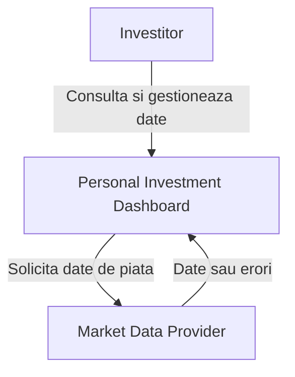
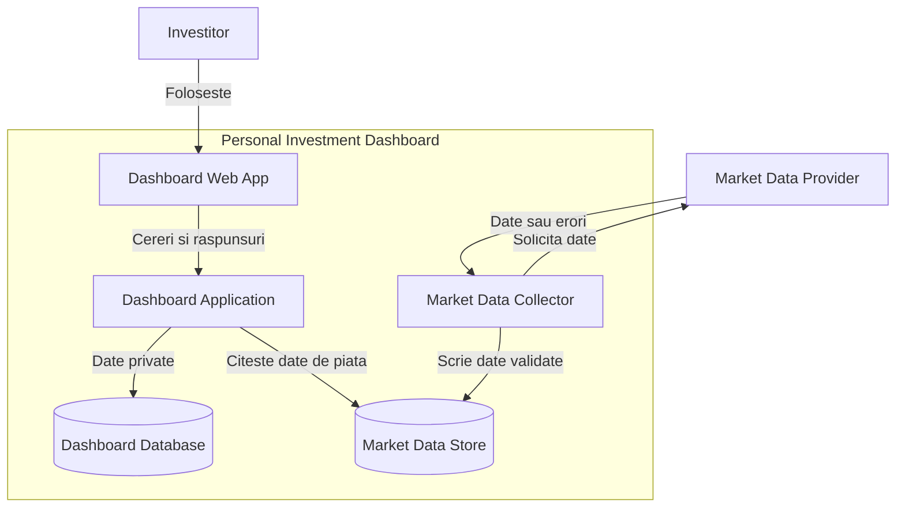
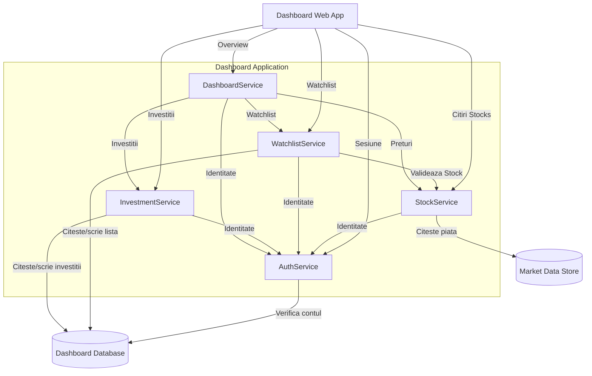
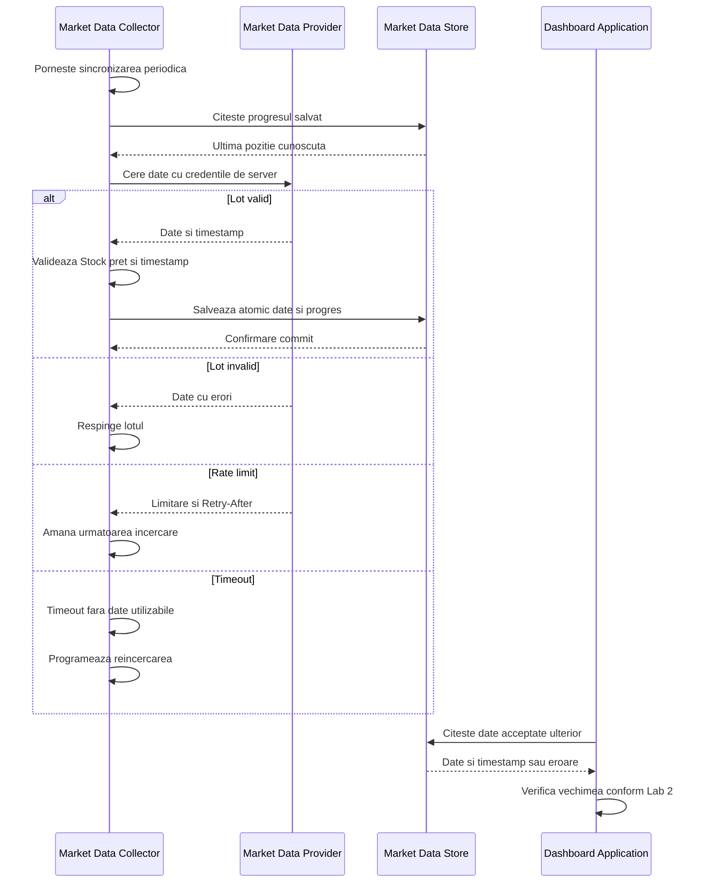
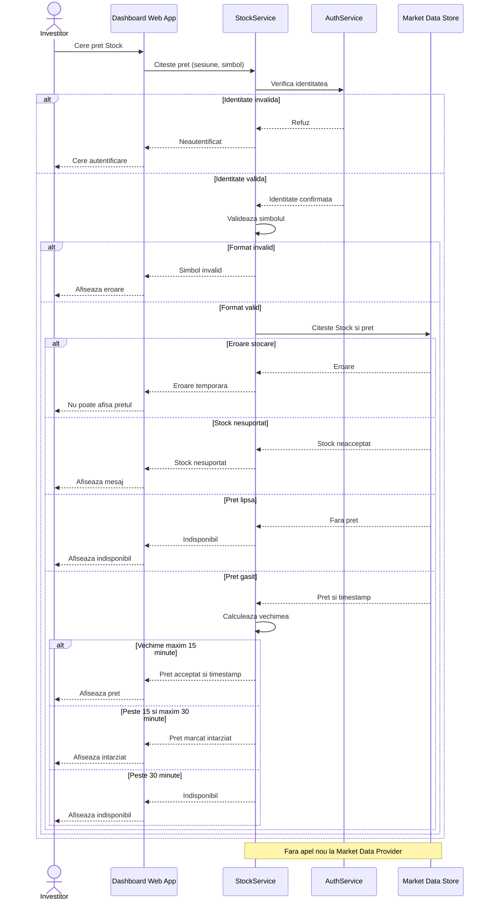
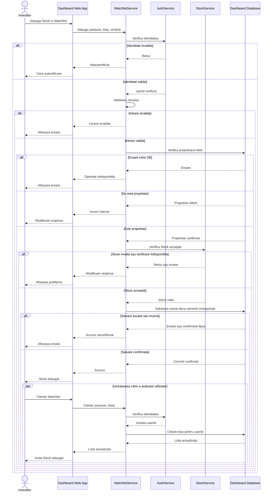

# Laboratorul 3 — Desenează limita Dashboard-ului

## Scop și continuitate

Proiectul continuă **Personal Investment Dashboard** din Laboratoarele 1 și 2. În V1, sistemul urmărește acțiuni de pe **Nasdaq Helsinki Main Market**, cu prețuri furnizate de un **Market Data Provider** extern. Nu permite tranzacții financiare. Utilizatorul autentificat poate căuta, filtra și urmări Stocks, prețuri, istoric, propriile investiții și un Watchlist privat.

Din Laboratorul 2 păstrăm: **p95 ≤ 2 s** pentru citirile corecte în perioadele aglomerate; o țintă estimată de capacitate de **10.296 RPS** pentru 30.000 de utilizatori la deschiderea pieței; prețuri de **cel mult 15 min acceptate**, **peste 15 și cel mult 30 min etichetate ca întârziate**, respectiv **peste 30 min indisponibile**. Sincronizarea este o ipoteză de V1: datele de referință zilnic, prețurile și istoricul la 15 minute în timpul tranzacționării.

**Notă de prezentare:** Diagramele folosesc etichete scurte pentru lizibilitate; tabelele descriu responsabilitățile în detaliu. Pentru a adapta automat lățimea diagramelor în Obsidian, se poate activa fișierul CSS oferit separat.

## 1. Diagrama System Context

**Explicație:** System Context arată întregul Dashboard ca **un singur sistem** și interacțiunile lui cu Investitorul și cu furnizorul extern; nu prezintă părți interne de execuție.

## 2. Diagrama Container

| Container | Responsabilitate |
| --- | --- |
| Dashboard Web App | Interfața utilizatorului și afișarea rezultatelor |
| Dashboard Application | Verifică identitatea, procesează citirile și modifică datele private |
| Dashboard Database | Stochează conturi, investiții și Watchlist-uri private |
| Market Data Collector | Sincronizează și validează datele furnizorului în fundal |
| Market Data Store | Stochează informațiile de piață acceptate și progresul sincronizării |

**Decizie de arhitectură:** Sincronizarea este periodică, în fundal. O citire Stock price nu trimite o nouă cerere direct către Market Data Provider. Cele două stocări reprezintă responsabilități logice diferite, fără alegerea obligatorie a două tehnologii.

## 3. Diagrama Component — Dashboard Application

| Componentă | Responsabilitate |
| --- | --- |
| AuthService | Identifică utilizatorul și verifică sesiunea |
| StockService | Search, Filter, Stock price, History și verificarea Stocks acceptate |
| WatchlistService | Acces autorizat și modificări pentru Watchlist-ul privat |
| InvestmentService | Active și cantități înregistrate de investitor |
| DashboardService | Combină datele necesare pentru Overview |

**Limită:** numai `Dashboard Application` este deschisă în componente. `Market Data Collector` este în continuare un container separat, deci nu apare ca o componentă a acestei aplicații.

## 4A. Secvență — Sincronizează datele de piață

**Ipoteze inițiale:**

- Market Data Collector sincronizează datele independent de cererile utilizatorilor: referințele Stock zilnic înainte de deschidere, latest price și history la 15 minute în timpul tranzacționării.
- Credențialele Market Data Provider rămân în Market Data Collector, pe server, niciodată în Dashboard Web App.
- Datele sunt validate înainte de scriere; un preț negativ ori un timp invalid este respins. Lipsa unui preț nu este echivalentă cu zero.
- Datele și progresul sincronizării sunt confirmate împreună, atomic. O salvare neconfirmată nu este raportată drept succes; o reîncercare trebuie să fie sigură împotriva dublurilor.
- Dacă furnizorul nu poate fi sincronizat, datele acceptate anterior nu se șterg. Citirile le pot afișa numai conform regulilor de vechime din Lab 2. Dacă salvarea datelor eșuează sau este neconfirmată, nu se declară sincronizarea reușită și nu se avansează progresul fără confirmare.

## 4B. Secvență — Citește prețul unui Stock

**Ipoteze inițiale:**

- Identitatea este verificată înainte de citirea datelor; simbolul primit este validat, apoi se verifică dacă Stock este acceptat de V1 (Nasdaq Helsinki Main Market).
- Datele provin din Market Data Store, alimentat periodic de Market Data Collector; **citirea nu apelează furnizorul**.
- Vechimea rezultă din timestamp-ul furnizorului: ≤15 min acceptat; >15 min până la 30 min etichetat „întârziat”; >30 min „indisponibil”.
- Un preț lipsă nu este zero. O eroare de stocare nu este echivalentă cu lipsa prețului.

## 4C. Secvență — Modifică un Watchlist privat

**Ipoteze inițiale:**

- Utilizatorul solicită adăugarea unui Stock în propriul Watchlist privat. Identitatea este stabilită de AuthService.
- WatchlistService verifică operația, datele de intrare și **proprietarul Watchlist-ului** înainte de scriere. Pentru adăugare, cere StockService să verifice dacă acțiunea este acceptată de V1.
- Dashboard Database păstrează Watchlist-urile private; scrierea impune din nou proprietarul verificat.
- Un rezultat de salvare lipsă sau nesigur **nu este succes**. Succesul se comunică numai după confirmarea stocării.
- După o modificare confirmată, următoarea citire reușită a aceluiași utilizator trebuie să reflecte modificarea (read-your-writes).

## Verificare finală

- [x] O diagramă System Context, una Container și una Component.
- [x] Trei diagrame de secvență: sincronizare, citire Stock price, modificare Watchlist.
- [x] Confirmă afișarea tuturor celor șase blocuri Mermaid în Obsidian (sintaxa a fost verificată separat).
- [x] Component deschide numai `Dashboard Application`.
- [x] Sunt incluse rezultatele normale, acțiunile respinse și defectările cerute.
- [x] Sunt acoperite citirile, datele private, sincronizarea furnizorului și regulile de consistență din Lab 2.

**Notă:** Cele 10.296 RPS reprezintă o **țintă estimată**, nu capacitate demonstrată. Aceasta trebuie validată ulterior prin teste de încărcare.
